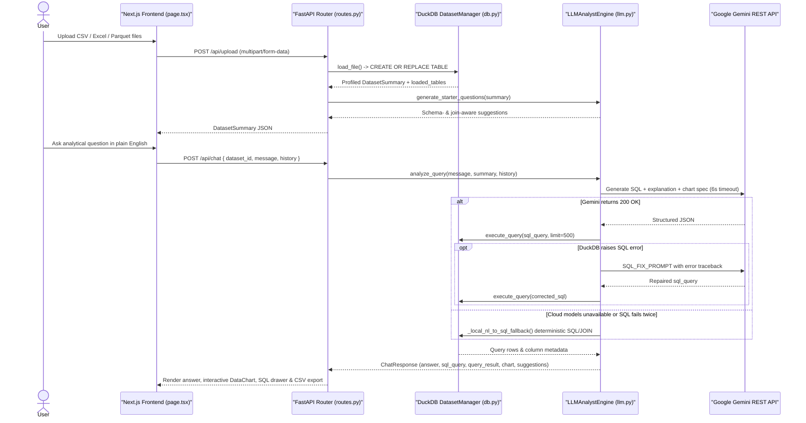

# 📊 Quick Analysis — AI-Powered Data Analyst & Multi-Table SQL Workspace

**Quick Analysis** is a full-stack AI data analytics workspace that transforms plain-English questions into deterministic **DuckDB SQL** queries, interactive **Plotly.js** charts, and executive **PDF / Markdown** reports. Users can upload single or multiple structured files (`.csv`, `.xlsx`, `.xls`, `.parquet`), automatically detect joinable keys across tables, run relational SQL `JOIN` queries, switch chart types on the fly, and inspect complete SQL audit trails.

- **Live Web App (Vercel)**: https://racing-krypton-xyk3apu-divykamalpuria04-gmailcoms-projects.vercel.app
- **GitHub Repository**: https://github.com/Di-vY/Quick-analysis

---

## 🌟 Core Capabilities

### 1. Multi-Table In-Memory DuckDB Engine
- **Instant File Ingestion**: Supports **CSV** (`read_csv_auto`), **Excel** (`.xlsx`, `.xls` via Pandas), and **Parquet** (`read_parquet`).
- **Multi-Table Relational Workspace**: Upload multiple files at once or incrementally; each file is registered under its sanitized SQL table name (e.g., `sales_data`, `region_targets`) while `data_table` dynamically aliases the currently active table.
- **Auto-Join Key Detection**: Automatically discovers matching column names across loaded tables (e.g., `Region`) and surfaces `Auto-Join Ready` badges and starter cross-table join prompts.
- **Built-In Demos**:
  - **Load Sample**: Instant 15-row retail sales dataset (`sales_data.csv`).
  - **2-Table Join Demo**: Loads `sales_data.csv` alongside `region_targets.csv` (`Region`, `Regional_Manager`, `Quarterly_Target`, `Headcount`, `Office_Location`) to test relational SQL `JOIN`s immediately.

### 2. High-Availability AI Analyst & Self-Healing SQL
- **Low-Latency Multi-Model Failover**: Direct `httpx` REST client (6s timeout per attempt) cycling across `gemini-3.5-flash`, `gemini-3.6-flash`, and `gemini-3.8-flash`.
- **Self-Healing SQL Execution**: When a generated query fails in DuckDB, `LLMAnalystEngine._execute_with_self_healing()` catches the exact database error and invokes `SQL_FIX_PROMPT` to auto-repair column names, quoting, or dialect syntax before returning results.
- **Zero-Downtime Local DuckDB Fallback**: If all cloud LLM endpoints are unreachable or experience temporary `503` capacity spikes, `_local_nl_to_sql_fallback()` deterministically synthesizes DuckDB SQL aggregations, `COUNT`/`SUM`/`AVG` groupings, top-N rankings, and multi-table `JOIN` queries locally.
- **Dataset-Aligned Suggestions (0ms)**: `generate_starter_questions()` inspects column types (numeric, categorical, temporal) and relational join keys to generate tailored starter questions immediately upon upload.

### 3. 5-Tab Workspace Interface (Light & Dark Mode)
Designed around a deep navy navigation rail (`#07112c`) with persistent Light/Dark mode support (`localStorage` key `app-theme`):
- **Overview**: Conversational AI chat, starter & follow-up question chips, interactive Plotly visualizations, expandable **View DuckDB SQL** drawers, and 1-click query result CSV export (`query_result.csv`).
- **Data**: Summary KPI cards (`Dataset File`, `Total Rows`, `Total Columns`), tabular **Data Preview** (first 5 rows), **View Full Table** preview modal, **Export CSV** preview button, and searchable **Column Schema** cards showing data types, null counts, and distinct sample values.
- **SQL Workspace**: Interactive DuckDB SQL editor (`Ctrl + Enter` / `Cmd + Enter` shortcut), live execution timer (`ms`), clickable table/column chips that insert identifiers at the prompt cursor, auto-generated `INNER JOIN` / `LEFT JOIN` templates, and CSV output download.
- **History**: Chronological audit log of session answers and executed DuckDB SQL snippets with **Open in SQL** deep-linking and one-click session report exports.
- **Settings**: Light/Dark theme toggle, active engine overview (Gemini 3.5 Flash + DuckDB), live FastAPI backend connectivity indicator (`Connected` / `Offline`), and **Clear Chat History** reset.

### 4. On-the-Fly Interactive Chart Switcher (`DataChart.tsx`)
- Switch any generated visualization instantly on the client between **Bar**, **Line**, **Pie** (donut), and **Scatter** charts without re-querying the backend.
- Automatically renders **X-Axis** and **Y-Axis** dropdown selectors whenever a query returns 3 or more columns.
- Full Plotly modebar with zoom, pan, hover tooltips, and PNG image export, automatically styled for Light and Dark themes.

### 5. 1-Click Executive Report Export (`exportReport.ts`)
- **Export PDF**: Opens a print-ready Executive Report window formatted with dataset KPI cards, Q&A findings, dark-themed DuckDB SQL blocks, and tabular query results, invoking the browser print-to-PDF dialog.
- **Report .MD**: Downloads a structured Markdown report (`quick_analysis_<dataset>_report.md`) containing dataset schema tables, questions, explanations, SQL blocks, and top-10 Markdown result tables.

---

## 🏗️ System Architecture

```
┌────────────────────────────────────────────────────────────────────────────┐
│                   Next.js 16 / React 19 UI (Frontend)                      │
│   Static Export (`output: "export"`) • Tailwind CSS v4 • Plotly.js         │
│                                                                            │
│   NavigationSidebar (Overview │ Data │ SQL Workspace │ History │ Settings) │
│   TopNav (Multi-Table DuckDB Bar • Auto-Join Badges • Export PDF / .MD)    │
│   DataChart (Live Bar/Line/Pie/Scatter & Axis Switcher)                    │
└─────────────────────────────────────┬──────────────────────────────────────┘
                                      │ HTTPS / REST JSON
                                      │ (`NEXT_PUBLIC_API_URL` or localhost:8000)
┌─────────────────────────────────────▼──────────────────────────────────────┐
│                       FastAPI Backend (Python 3.13)                        │
│                                                                            │
│  ┌───────────────────────────────┐    ┌─────────────────────────────────┐  │
│  │       DatasetManager          │    │        LLMAnalystEngine         │  │
│  │  - Multi-file table registry  │◄──►│  - Gemini 3.5/3.6/3.8 Flash     │  │
│  │  - Active `data_table` view   │    │  - Self-healing SQL repair      │  │
│  │  - Join key auto-detection    │    │  - Local DuckDB NL2SQL fallback │  │
│  └───────────────┬───────────────┘    └────────────────┬────────────────┘  │
│                  │                                     │                   │
│                  ▼                                     ▼                   │
│  ┌──────────────────────────────────────────────────────────────────────┐  │
│  │               DuckDB In-Memory Analytical SQL Engine                 │  │
│  │     Sub-millisecond aggregations, filters, and cross-table JOINs     │  │
│  └──────────────────────────────────────────────────────────────────────┘  │
└────────────────────────────────────────────────────────────────────────────┘
```



---

## 🛠️ Tech Stack

| Layer | Technology | Version / Details |
| :--- | :--- | :--- |
| **Frontend Framework** | Next.js + React + TypeScript | Next.js `16.4.5` (`--webpack`, `output: "export"`), React `19.3.0`, TypeScript `^5` |
| **Styling & Icons** | Tailwind CSS v4 + Lucide React | `@tailwindcss/postcss` `^4.3.4`, `lucide-react` `^1.68.0` |
| **Data Visualization** | Plotly.js + React Markdown | `plotly.js-dist-min` `^4.2.0`, `react-plotly.js` `^4.1.0`, `remark-gfm` |
| **Backend Framework** | FastAPI + Uvicorn + Pydantic | FastAPI `0.115.8`, Uvicorn `0.34.0`, Pydantic `2.10.6` |
| **Analytical Engine** | DuckDB + Pandas + OpenPyXL | In-memory columnar SQL engine (`:memory:`) |
| **AI / LLM Client** | `httpx` -> Gemini REST API | `gemini-3.5-flash` primary with `gemini-3.6-flash` & `gemini-3.8-flash` fallback |

---

## 📡 REST API Reference

Base URL: `http://127.0.0.1:8000` (local) or your deployed Render backend URL. Interactive Swagger docs are served at `/docs`.

| Method | Endpoint | Description | Request | Response |
| :--- | :--- | :--- | :--- | :--- |
| `GET` | `/` | Service metadata & docs pointer | — | `{"status": "online", "service": "Quick Analysis API", "docs": "/docs"}` |
| `GET` | `/api/health` | Health check polled by frontend every 4s | — | `{"status": "ok"}` |
| `POST` | `/api/upload` | Ingest `.csv`, `.xlsx`, `.xls`, `.parquet` into DuckDB | `file` (`multipart/form-data`) | `DatasetSummary` |
| `GET` | `/api/dataset/current` | Fetch active dataset schema, preview & loaded tables | — | `DatasetSummary` (`404` if empty) |
| `POST` | `/api/tables/{table_name}/activate` | Switch active table & update `data_table` view alias | Path: `table_name` | `DatasetSummary` |
| `DELETE` | `/api/tables/{table_name}` | Drop table from DuckDB & switch active table | Path: `table_name` | `{"active_dataset": DatasetSummary \| null}` |
| `POST` | `/api/chat` | Convert question to SQL, run in DuckDB & build chart | `{ "dataset_id", "message", "history" }` | `ChatResponse` |
| `POST` | `/api/query/sql` | Execute raw DuckDB SQL (capped at 500 rows) | `{ "sql": "SELECT ..." }` | `{ "columns", "rows", "count" }` |

### Example `POST /api/chat` Response Shape
```json
{
  "answer": "Executed a relational **SQL JOIN** between `sales_data` and `region_targets` on key `Region` (4 rows returned).",
  "sql_query": "SELECT a.\"Region\", ROUND(SUM(a.\"Sales\"), 2) AS \"Total_Sales\", ROUND(AVG(b.\"Quarterly_Target\"), 2) AS \"Quarterly_Target\" FROM \"sales_data\" a JOIN \"region_targets\" b ON a.\"Region\" = b.\"Region\" GROUP BY a.\"Region\" ORDER BY \"Total_Sales\" DESC LIMIT 20",
  "query_result": [{ "Region": "West", "Total_Sales": 3506.1, "Quarterly_Target": 3000.0 }],
  "chart": {
    "chart_type": "bar",
    "title": "Joined sales_data & region_targets by Region",
    "x_column": "Region",
    "y_column": "Total_Sales",
    "data": [{ "Region": "West", "Total_Sales": 3506.1, "Quarterly_Target": 3000.0 }]
  },
  "suggestions": [
    "Join sales_data and region_targets on Region to compare metrics",
    "What is the total Sales by Customer_Name?",
    "Show top 5 Region by Sales"
  ],
  "error": null
}
```

---

## 📁 Project Structure

```text
DataAnalyst/
├── backend/
│   ├── app/
│   │   ├── api/
│   │   │   └── routes.py              # REST endpoints (/upload, /chat, /query/sql, /tables/*)
│   │   ├── core/
│   │   │   ├── db.py                  # DatasetManager: DuckDB tables, join detection, SQL runner
│   │   │   ├── llm.py                 # LLMAnalystEngine: Gemini failover, self-healing & local fallback
│   │   │   └── prompts.py             # SYSTEM_ANALYST_PROMPT & SQL_FIX_PROMPT templates
│   │   ├── models/
│   │   │   └── schemas.py             # Pydantic models (DatasetSummary, TableMetadata, ChatResponse)
│   │   ├── config.py                  # Settings, .env loading & CORS origin rules
│   │   └── main.py                    # FastAPI app initialization & middleware
│   ├── sample_data/
│   │   └── sales_data.csv             # 15-row sample retail sales CSV
│   ├── tests/
│   │   └── test_api.py                # FastAPI endpoint integration checks
│   ├── .env.example                   # Environment template (safe to commit)
│   └── requirements.txt               # Python dependencies
├── frontend/
│   ├── src/
│   │   ├── app/
│   │   │   ├── globals.css            # Tailwind CSS v4 entrypoint
│   │   │   ├── layout.tsx             # Root HTML shell & metadata ("Quick Analysis")
│   │   │   └── page.tsx               # Main application state, tab router & chat stream
│   │   ├── components/
│   │   │   ├── DataChart.tsx          # Plotly renderer + live Bar/Line/Pie/Scatter & axis switcher
│   │   │   ├── DataExplorerView.tsx   # KPI cards, data preview grid & searchable column schema
│   │   │   ├── HistoryView.tsx        # Query audit trail + SQL Workspace jump + report exports
│   │   │   ├── NavigationSidebar.tsx  # Deep navy (#07112c) sidebar + theme switcher
│   │   │   ├── PreviewModal.tsx       # Modal table viewer for active dataset
│   │   │   ├── SettingsView.tsx       # Theme toggle, engine status, FastAPI health & reset
│   │   │   ├── SqlWorkspaceView.tsx   # Direct DuckDB SQL editor, schema chips & JOIN templates
│   │   │   ├── TopNav.tsx             # Header actions, multi-table DuckDB pills & auto-join badge
│   │   │   └── WelcomeCard.tsx        # Empty-state onboarding card
│   │   ├── lib/
│   │   │   ├── api.ts                 # Fetch client wired to NEXT_PUBLIC_API_URL
│   │   │   └── exportReport.ts        # Markdown (.md) & printable PDF executive report generators
│   │   └── types/
│   │       └── index.ts               # Shared TypeScript interfaces matching Pydantic schemas
│   ├── next.config.ts                 # Static export (`output: "export"`) & strict mode config
│   ├── package.json                   # Frontend dependencies & `--webpack` dev/build scripts
│   └── postcss.config.mjs             # `@tailwindcss/postcss` configuration
├── render.yaml                        # Render Blueprint spec for deploying backend/
├── run_backend.bat                    # Windows script: launches FastAPI via backend/venv
├── run_frontend.bat                   # Windows script: launches Next.js dev server
├── start.bat                          # Windows script: launches both backend & frontend
└── .gitignore                         # Excludes secrets (.env), venv, node_modules, build outputs
```

---

## 💻 Local Development Setup

### Prerequisites
- **Python 3.12 / 3.13** (precompiled wheels available for all scientific/database packages; Windows Python 3.14 is not recommended due to `pydantic-core` build wheels)
- **Node.js 20+** and `npm`
- A free Gemini API key from [Google AI Studio](https://aistudio.google.com/app/apikey)

### 1. Backend Setup
```powershell
cd backend
python -m venv venv
.\venv\Scripts\pip.exe install -r requirements.txt
copy .env.example .env
# Edit backend\.env and paste your GEMINI_API_KEY
```

### 2. Frontend Setup
```powershell
cd frontend
npm install
```

### 3. Run Locally
- **One-Click (Windows)**: Double-click `start.bat` at the project root.
- **Manual Launch**:
  - Terminal 1: `cd backend && .\venv\Scripts\python.exe -m uvicorn app.main:app --host 127.0.0.1 --port 8000 --reload`
  - Terminal 2: `cd frontend && npm run dev`
- Open **http://localhost:3000** (UI) and **http://127.0.0.1:8000/docs** (FastAPI Swagger UI).

---

## ☁️ Cloud Deployment Architecture

Quick Analysis separates the static Next.js UI (**Vercel**) from the stateful Python + DuckDB analytical backend (**Render** / **Railway**):

1. **Frontend (Vercel — Connected to `Di-vY/Quick-analysis` `main` branch)**:
   - **Root Directory**: `frontend`
   - **Framework Preset**: `Next.js` (uses `next.config.ts` with `output: "export"`).
   - **Environment Variable**: Set `NEXT_PUBLIC_API_URL` to your deployed backend URL (e.g., `https://quick-analysis-backend.onrender.com`, without a trailing slash).
2. **Backend (Render via `render.yaml`)**:
   - Create a **New Blueprint Instance** on Render connected to `Di-vY/Quick-analysis`.
   - `render.yaml` sets `rootDir: backend`, installs `requirements.txt`, starts `uvicorn app.main:app --host 0.0.0.0 --port $PORT` on Python `3.12.8`, and prompts for `GEMINI_API_KEY`.
   - CORS in `backend/app/main.py` automatically permits `*.vercel.app`, `*.onrender.com`, `*.up.railway.app`, plus any explicit `FRONTEND_URL` environment variable.

### Continuous Development Workflow
1. Edit and verify features locally with `run_backend.bat` and `run_frontend.bat`.
2. Push changes to GitHub (`git add . && git commit -m "..." && git push origin main`).
3. Vercel (and Render, if connected) automatically rebuilds and publishes the updated `main` branch.

---

## 🔒 Security & Data Privacy Notes
- Uploaded files are stored locally under `backend/uploads/` (gitignored) and queried inside an in-memory DuckDB session (`:memory:`).
- `SELECT` queries run via the SQL Workspace or chat engine are wrapped in `SELECT * FROM (...) LIMIT 500` to protect memory on large tables.
- Only schema metadata, column types, 3 sample rows, and user questions are sent to the Gemini API—full raw datasets stay inside DuckDB.
- API keys (`backend/.env`) are excluded from version control via `.gitignore`.
